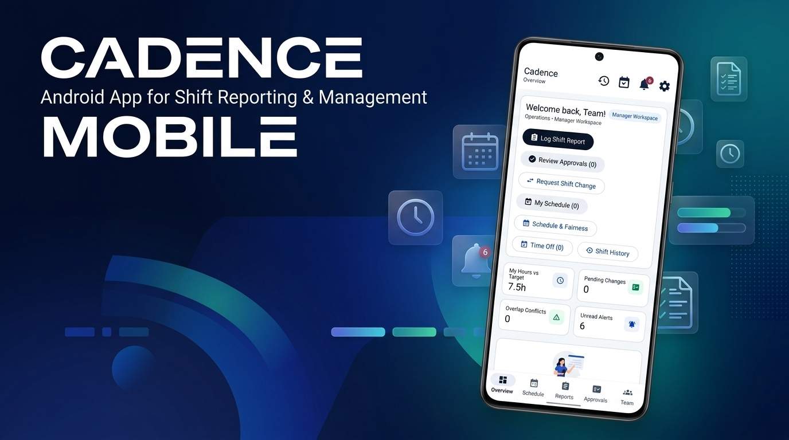

# Cadence — Shift Reporting & Fair Scheduling (Android)# Cadence — Shift Reporting & Fair Scheduling (Android)

Cadence is a native Android application built with **Kotlin**, **Jetpack Compose (Material 3)**, and **Firebase (Firestore + Google Sign-In)** for shift reporting, manager approvals, push notifications, and fairness-balanced overlap scheduling.

## Features

- **Google Sign-In Authentication**: Uses Jetpack Credential Manager (`GetSignInWithGoogleOption` and `GetGoogleIdOption`) with Firebase Auth and automatic role provisioning (`managers` vs `staff`).
- **Overview Dashboard**: Live KPI tiles, quick actions to log shift reports or navigate queues, upcoming shifts, recent reports, and alert feeds.
- **Schedule & Fairness Engine**:
  - Weekly and monthly shift calendar views, searchable/filterable shift table (`All`, `Mine`, `Open`, `Overlaps`, `Completed`), and staff availability submissions.
  - Fairness scoring (`(totalHoursWorked + scheduledHours) / weeklyHoursTarget`, shift count, and `lastAssignedAt` tie-breaker) that excludes approved time-off and overlapping shifts.
  - One-tap **Arrange Overlaps**, **Assign Open**, **Generate Week**, customizable **Week Slots**, and staff **Request Change / Swap / Drop / Claim**.
  - **Calendar Sync**: Direct **Add to Google Calendar** intent and `.ics` file export via `FileProvider`.
- **Shift Reports**: Staff clock-in/out & handoff reporting with automatic net hours calculation and manager **Verify / Flag** verification that credits verified hours to the staff ledger.
- **Manager Approvals (One-Click Accept All)**: Review individual schedule change requests or batch-approve all pending changes in Firestore batches while notifying affected staff.
- **Time Off Requests**: Staff submit and withdraw date ranges; managers approve or deny with instant notifications and fairness scheduler exclusions.
- **Notifications Center**: Real-time Firestore notification stream paired with Android `NotificationManagerCompat` local alerts (`POST_NOTIFICATIONS` on Android 13+).
- **Team & Hours Ledger**: Stacked hours-vs-target progress visualization, staff utilization ratio ledger, roster member creation, manager role toggling, and sample workspace seeding.

## Architecture & Tech Stack

- **Language & UI**: Kotlin, Jetpack Compose, Material Design 3, adaptive `NavigationBar` / `NavigationRail`
- **Backend**: Cloud Firestore (`ai-studio-android-cadence-183febb7-d213-4d58-bab0-c77de3ebb109` on Firebase project `silken-eye-377716`) with `firestore.rules`
- **Auth**: Firebase Authentication with Google Sign-In via Credential Manager
- **Testing**: Local JVM Robolectric + Firebase Emulator integration tests (`CadenceRepositoryRuleTest`)

## Download

The released APK is available at https://borisli713.github.io/Cadence-Mobile/.
